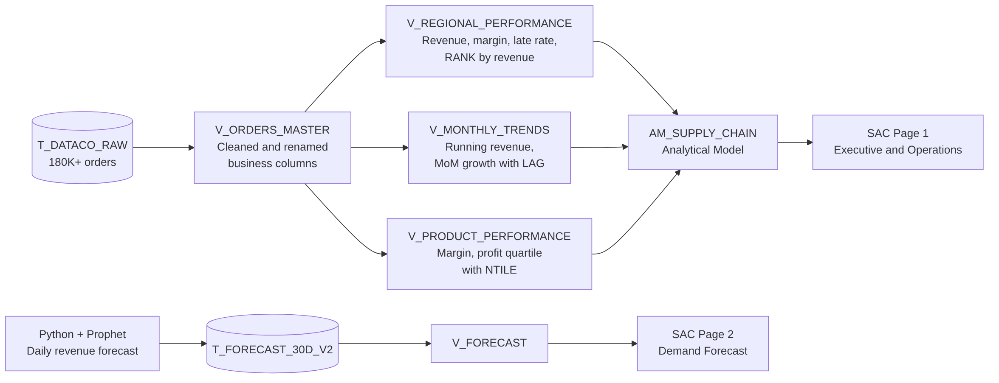

# Supply Chain Analytics with SAP Datasphere and SAP Analytics Cloud

**End-to-end supply chain analytics on 180,000+ orders: a layered data model in SAP Datasphere, two executive dashboards in SAP Analytics Cloud and a 30-day revenue forecast with Prophet (Python), all connected in one SAP data flow.**


---

## At a Glance

| Metric | Result |
|---|---|
| Orders analysed | **180,000+** (DataCo Smart Supply Chain dataset) |
| Total revenue / profit | **$36.78M / $4.0M** |
| Late order rate | **54.83%** |
| Average shipping time | **3.5 days** |
| Top revenue region | **Central America: $5.67M (15.4% of revenue)** |
| Most profitable category | **Fishing: $756K profit** |
| 30-day revenue forecast | **$490K** (range **$210K to $770K**) |

---

## Dashboards

### Page 1: Executive and Operations


- **KPI cards:** total revenue, net profit, late order rate and average shipping days
- **Profit by category:** which product categories actually make money
- **Revenue by shipping mode:** Standard Class carries **59.9%** of revenue
- **Revenue by region** and **late deliveries by region**, side by side, to show where revenue and delivery problems overlap
- **Filters** for order region and category, plus a key findings panel for executives

### Page 2: Demand Forecast (Prophet ML Model)


- **Predicted, best-case and worst-case revenue** for the next 30 days
- **Predicted revenue with confidence bands** (upper and lower bound) per day
- **Daily forecast breakdown table** for planners

---

## Business Problem

DataCo, a global retailer, ships orders to customers in more than 20 regions. Management needs answers to three questions:

1. **Where does the revenue and profit come from?** (regions, categories, products)
2. **Why are so many orders late, and where?** (shipping mode, region)
3. **How much revenue can we expect next month?** (for inventory and capacity planning)

---

## Key Insights

1. **More than half of all orders arrive late (54.83%).** **Standard Class** shipping is the main driver, and it carries almost 60% of revenue, so the biggest revenue stream is also the biggest delivery risk.
2. **Central America is the top revenue region** with **$5.67M (15.4%)**, but it also has the **highest number of late deliveries (15,518)**. Western Europe shows the same pattern. The most important regions have the biggest delivery problem.
3. **Fishing is the most profitable category** with **$756K** profit, followed by Cleats ($490K) and Camping & Hiking ($430K). Computers and Shop By Sport add very little profit.
4. **The Prophet forecast predicts about $490K revenue for the next 30 days**, with a realistic range of $210K to $770K. That's roughly $15K to $18K per day for planning.

### Business Recommendations

- **Review Standard Class carriers and delivery promises** in Central America and Western Europe first, where revenue and late deliveries are highest.
- **Protect high-margin categories** (Fishing, Cleats, Camping & Hiking) with priority shipping and stock availability.
- **Use the 30-day forecast with its confidence range** for inventory and capacity planning instead of a single number.

---

## Architecture

The project uses a **layered view architecture** in SAP Datasphere: one cleaned master view, three business views on top of it, one analytical model, and a separate forecast flow from Python into the same model layer.



---

## SQL Data Model

All views are SQL views in SAP Datasphere. The SQL files are in [`sql/`](sql/).

| View | Purpose | Key techniques |
|---|---|---|
| [`V_ORDERS_MASTER`](sql/V_ORDERS_MASTER.sql) | Single cleaned source: selects and renames the 14 business-relevant columns from the raw table | Column mapping, consistent naming |
| [`V_REGIONAL_PERFORMANCE`](sql/V_REGIONAL_PERFORMANCE.sql) | Revenue, profit, margin and late order rate per region | `RANK() OVER`, `NULLIF` for safe division |
| [`V_MONTHLY_TRENDS`](sql/V_MONTHLY_TRENDS.sql) | Monthly revenue, profit and order count, running total and month-over-month growth | `SUM() OVER` (running total), `LAG()` (MoM growth %) |
| [`V_PRODUCT_PERFORMANCE`](sql/V_PRODUCT_PERFORMANCE.sql) | Revenue, profit and margin per product and category, grouped into profit quartiles | `NTILE(4) OVER` |
| [`V_FORECAST`](sql/V_FORECAST.sql) | Exposes the Prophet forecast (predicted value and bounds) to SAC | Business column naming for reporting |

**Example: month-over-month growth with `LAG()`**

```sql
ROUND((SUM(SALES) - LAG(SUM(SALES)) OVER (ORDER BY YEAR(ORDER_DATE), MONTH(ORDER_DATE)))
      / NULLIF(LAG(SUM(SALES)) OVER (ORDER BY YEAR(ORDER_DATE), MONTH(ORDER_DATE)), 0) * 100, 2)
      AS MOM_GROWTH_PCT
```

---

## Demand Forecast (Python + Prophet)

The script [`notebooks/demand_forecast.py`](notebooks/demand_forecast.py):

1. Loads the DataCo dataset and parses order dates
2. Aggregates sales to **daily revenue**
3. Trains a **Prophet** model with **yearly and weekly seasonality**
4. Predicts the **next 30 days** with lower and upper confidence bounds
5. Exports `forecast_30d.csv`, which is loaded into Datasphere as `T_FORECAST_30D_V2` and shown in SAC through `V_FORECAST`

This connects a Python ML model to an SAP analytics landscape, the way forecasts are often brought into enterprise reporting.

---

## Tech Stack

| Area | Tools |
|---|---|
| Data modelling | SAP Datasphere (SQL views, analytical model) |
| Reporting | SAP Analytics Cloud (stories, KPIs, linked analysis, filters) |
| Query language | SQL with window functions (`RANK`, `LAG`, `SUM OVER`, `NTILE`) |
| Forecasting | Python, Pandas, Prophet |
| Version control | Git, GitHub |

---

## Repository Structure

```
supply-chain-sap-analytics/
├── sql/
│   ├── V_ORDERS_MASTER.sql          # Master view: cleaned business columns
│   ├── V_REGIONAL_PERFORMANCE.sql   # Region KPIs + revenue rank
│   ├── V_MONTHLY_TRENDS.sql         # Monthly trends, running revenue, MoM growth
│   ├── V_PRODUCT_PERFORMANCE.sql    # Product and category KPIs + profit quartiles
│   └── V_FORECAST.sql               # Forecast view for SAC
├── notebooks/
│   └── demand_forecast.py           # Prophet 30-day revenue forecast
├── screenshots/
│   ├── Executive & Operations.png   # SAC dashboard, page 1
│   ├── Demand Forecast.png          # SAC dashboard, page 2
│   └── architecture_supply_chain.png  # Architecture diagram
└── README.md
```

---

## How to Reproduce

1. **Get the data:** download the [DataCo Smart Supply Chain dataset](https://www.kaggle.com/datasets/shashwatwork/dataco-smart-supply-chain-for-big-data-analysis) from Kaggle (`DataCoSupplyChainDataset.csv`).
2. **Load into SAP Datasphere:** upload the CSV as a local table called `T_DATACO_RAW`.
3. **Create the views:** create SQL views in Datasphere with the files in `sql/`, starting with `V_ORDERS_MASTER`.
4. **Build the analytical model** `AM_SUPPLY_CHAIN` on top of the business views.
5. **Run the forecast:**
   ```bash
   pip install pandas prophet
   python notebooks/demand_forecast.py
   ```
   Upload `forecast_30d.csv` to Datasphere as `T_FORECAST_30D_V2` and create `V_FORECAST`.
6. **Build the SAC story** on the analytical model and the forecast view.

---

## Next Steps

- Add **delivery delay prediction** per order (classification model) to flag risky orders before shipping
- Use **SAC Planning** to turn the forecast into an editable revenue plan with versions
- Forecast **per region and category** instead of total revenue only
- Connect the model to **SAP Business Data Cloud** for a live data pipeline

---

## Author

**Mayuresh Parche**
M.Sc. Software Engineering, Hochschule Heilbronn | SAP Certified Data Analyst (SAP Analytics Cloud)

[LinkedIn](https://www.linkedin.com/in/mayureshparche/) | [GitHub](https://github.com/Mayureshp21)
